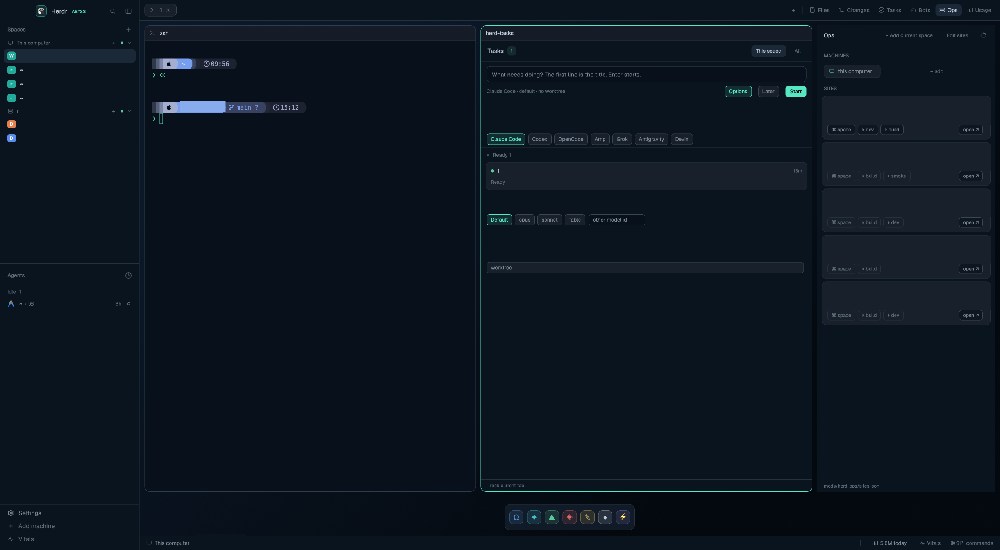
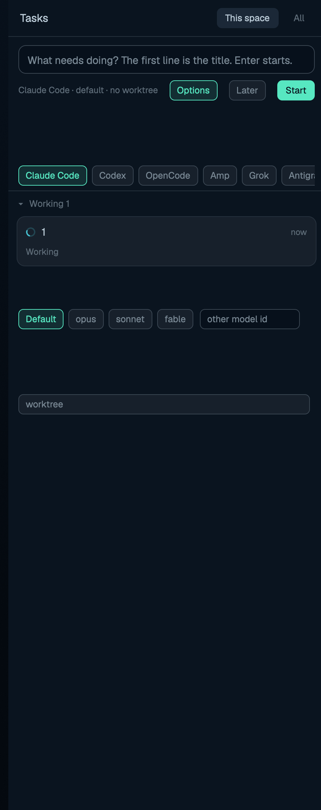
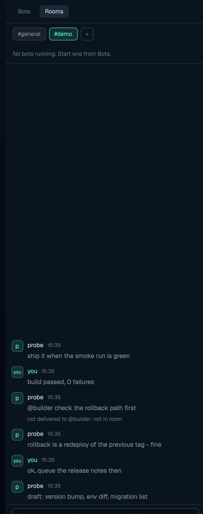
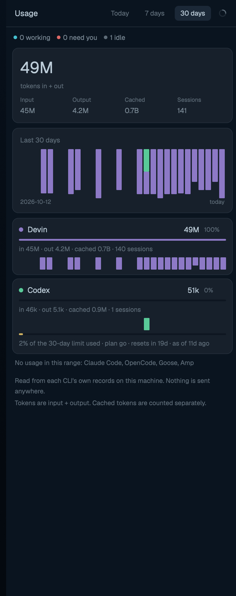
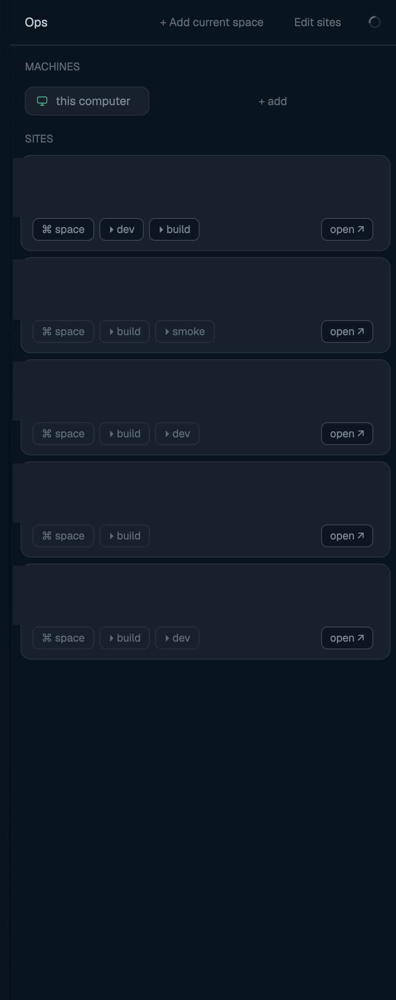

# Herdr: Abyss pack

A customization collection for the [Herdr](https://herdr.dev) app: the
**abyss** layout (deep-navy glass look, Abyssal Trench port) plus four
workflow mods — a task board, persona bots with shared rooms, a sites
launcher and an agent-usage meter. Everything runs on real Herdr
primitives (spaces, tabs, panes, agents), so it all shows up in the
mobile app's Inbox and Spaces exactly like on desktop.

Each package is a folder shaped like the Herdr app home
(`~/.config/herdr-app`); one repo holds several, per the gallery rules.

| Package | What it is | |
|---|---|---|
| [`abyss/`](./abyss/) | Layout + theme + chrome mods (sidebar, pill tabs, pane cards, status bar, floating bot dock); bundles generated copies of the herd-* mods |  |
| [`herd-tasks/`](./herd-tasks/) | Task board with Needs you/Ready/Working/Queued/Done sections; every task is a real named tab, optionally in a git worktree |  |
| [`herd-bots/`](./herd-bots/) | Persona bots: card list + ask dialog + floating dock + shared Rooms with a live feed |  |
| [`herd-usage/`](./herd-usage/) | Token usage per agent CLI with a 30-day chart, read from each CLI's own local records |  |
| [`herd-ops/`](./herd-ops/) | Sites + machines launcher: one-click spaces and runbook terminals |  |
| [`third_party/vitals/`](./third_party/vitals/) | Vendored `mrolafsson/herdr-vitals` machine monitor — upstream, not ours | |

## Install

```sh
./install.sh
```

Idempotent: syncs the generated copies, installs the abyss suite into
`~/.config/herdr-app` (or `$HERDR_APP_HOME`), merges free key chords
without ever replacing yours, and `herdr-app check`s every mod. Flags:
`--dry-run`, `--link` (symlinks, for development), `--no-vitals`.

Then:

```sh
herdr-app do layout.switch '{"name":"abyss"}'
```

## Keys

| Key | Action |
|---|---|
| `⌘⌥T` | Toggle Tasks window |
| `⌘⌥B` | Toggle Bots window |
| `⌘⌥O` | Toggle Ops window |
| `⌘⌥U` | Toggle Usage window |
| `⌘⌥V` | Toggle Vitals window |
| `Esc` (in Vitals) | Close Vitals |

Each kept window can also open from its tab-bar button (right side of
the abyss tab bar) or by `herdr-app do mod.open:herd-<name>`.

## Requirements

- macOS (Linux should mostly work; untested)
- `herdr-app` installed and run once (the app home must exist)
- Python 3 — required by herd-bots rooms and herd-usage
- Git — required by herd-tasks worktree mode
- Any agent CLI you actually want bots/tasks to run (claude, codex, ...)

## Vitals (third_party/)

`third_party/vitals` is vendored from the upstream
[`mrolafsson/herdr-vitals`](https://github.com/mrolafsson/herdr-vitals)
mod, MIT licensed (see `third_party/vitals/LICENSE` + `NOTICE.md`). On
first open it downloads a checksummed `herdr-vitals` binary per machine
(`~/.local/share/herdr-vitals/app/<version>`) and runs `curl`, `tar`,
`sha256sum`/`shasum` on every machine it monitors, including remotes.
Skip it with `./install.sh --no-vitals`.

## Your data vs. shipped files

- Your config lives in the app home and is never touched by the repo:
  `~/.config/herdr-app/mods/herd-bots/bots.json` (personas),
  `mods/herd-ops/sites.json` (sites), `mods/herd-tasks/tasks.json`
  (agent/model config), and your `keys.json`. The mods create them from
  the shipped `*.default.json` on first edit; the installer merges keys
  add-only.
- The repo ships code, defaults and docs only — no personal data, no
  real site list, no tasks, no bots.
- Escape hatch if anything wedges: `ctrl-alt-shift-escape` resets
  layout + keys to Herdr defaults.

## Development

- `scripts/sync.sh` regenerates `abyss/mods/herd-*` from the
  canonical `herd-*/mods/*/` sources; `--check` reports drift.
- `scripts/check.sh` is the one verification gate: sync drift, JSON,
  Python and shell syntax, unit tests, `herdr-app check`, and a
  personal-data scan.
- `scripts/pngtool.py` (stdlib-only) crops `herdr-app shot` frames into
  the package `preview.png` files and blanks regions that must not ship
  (`--crop`, `--fill`, `--half`).
- Gallery topics: tag a repo holding a layout with `herdr-layout`, a
  mod with `herdr-mod`; this repo is both.

## Contributing

Issues and PRs welcome — open them on the repo. Keep `scripts/check.sh`
green and run `scripts/sync.sh` after editing a canonical mod.
