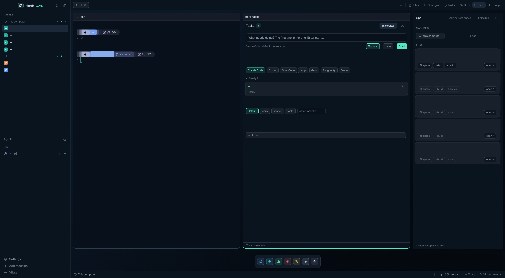

# Abyss

A dark, deep-navy Herdr window — an Abyssal Trench port: gradient canvas,
mint `#57e7c1` accent, translucent rounded pane cards, a left sidebar with
Spaces and Agents lists, pill tabs, a hidden right-hand panel stack for the
herd-* mods, a floating bot dock and a slim status bar.

## What you see

- Left sidebar, 272 px (`min 44`, `max 480`, not resizable), `chrome`
  `#0a141f` background:
  - 48 px brand row (drags the window): Herdr mark + "ABYSS" in mint.
  - Two equal-weight lists: **Spaces** and **Agents**, each `min 90` px —
    the shipped `spaces`/`agents` mods, so they behave exactly like the
    default layout's.
  - 98 px footer block (same `abyss-chrome` mod with `props {footer:true}`):
    Settings, Add machine, a "needs you" badge, and a Vitals entry only
    when the vitals mod is installed.
- Tab bar, 44 px (drags the window): unnamed-position pill tabs with a close
  `×`, agent-status dots, `+` menu, and right-aligned panel toggles
  (Files, Changes, Tasks, Bots, Ops, Usage chips).
- Work area: 10 px padding + 10 px gap around pane cards; each terminal is
  a card — `radius 12`, background `#0e1621f2` (≈97% opaque), hairline
  border `#2e3d4c`, mint `#57e7c1` focus ring, 32 px `abyss-pane` header.
- Right panel column, 380 px (`min 280`, `max 900`, resizable), hidden by
  default: a stack showing one of files / changes / herd-tasks / herd-bots /
  herd-ops / herd-usage at a time.
- Bottom floating `botdock` strip (herd-bots with `{dock:true}`), centered
  at the bottom edge: one glyph chip per bot, mint status dot when running.
- Status bar, 30 px, top border: machine · space · agents tally
  (working/blocked/done/idle counts), usage-today chip (when herd-usage is
  installed), Vitals chip (when installed), and a ⌘⌘P palette hint.
- Theme `abyss`: canvas `#07101b`, chrome `#0a141f`, surface `#0e1621`,
  raised `#17202b`, border `#26313d`, input `#3a4652`, text `#bcccd8`,
  muted `#798894`, dim `#5d6b77`, accent/solid `#57e7c1`, working
  `#45bfcf`, blocked `#d1b361`, done `#59ca98`. Window background is a
  `#0b1828 → #04090f` 155° gradient; ANSI palette ships in the theme.
- No system title bar (`titlebar: "none"`); macOS traffic lights drawn at
  `[12,16]`; `terminal_padding [16,14]`, `terminal_opacity 0.97`.

## How it behaves

- Agent status flows through the shipped mods unchanged: tab pills and the
  Agents list show working/blocked/done/idle with the theme colors; a
  blocked agent lights the footer's "needs you" badge and the status-bar
  tally. `settled` and remote spaces work via the shipped `spaces` mod.
- `+` in the tab bar opens the standard new-menu (terminal or any installed
  agent). Tab pills select/close; tabs are unnamed-position by default.
- Panel toggle chips in the tab bar call `layout.select {stack:"panel-body",
  child:<name>}` + `layout.show {id:"panel"}`; toggling the active one calls
  `layout.hide`. Panel state is per-space click state (`layouts/.state/`),
  so each space remembers which panels were open.
- The usage chip in the status bar (shows `4.9M today` from
  `shared("herd-usage.summary")`) opens the herd-usage panel; the Vitals
  chip runs `mod.open vitals`; both appear only when those mods exist
  (probed via `shared("abyss.has")`, refreshed once a minute).
- `abyss-status` doubles as herd-usage's loader: every tick it runs
  `python3 mods/herd-usage/usage.py --days 30` when the shared doc is
  missing, older than 5 min, or `herd-usage.refresh` is newer; failures
  back off 60 s. This is what lets the kept usage window render anything
  (kept windows are separate JS contexts).
- Keys merged by the package's `keys.json`: `global` `cmd-alt-t/b/o/u`
  → `mod.open:herd-{tasks,bots,ops,usage}` — each opens a kept window —
  and `mod:herd-*` `escape → herd-*.close` so Esc closes the kept window
  (its header also gets a `×` button).

## Built from

- `layouts/abyss.json`: root `row` → `sidebar` (brand block `abyss-chrome`,
  `sidebar-lists` with shipped `spaces` + `agents`, footer `abyss-chrome
  {footer:true}`) and `work` (tabs block `abyss-tabs`, `work-main` with
  `work-body` row `{tab:"active"}` + hidden `panel` stack, `dock-lane`
  spacer, floating `botdock` `{mod:"herd-bots", props:{dock:true}}`,
  status block `abyss-status`). `preview: layouts/abyss.svg`.
- `themes/abyss.json`: full palette + 16-color ANSI table (above).
- `keys.json`: global chord snippet to merge (add-only).
- Mods: `abyss-chrome` (brand/footer), `abyss-tabs` (tab pills + panel
  toggles; reads `spaces()`, `agents()`, `layout.select/show/hide`),
  `abyss-pane` (pane header), `abyss-status` (status bar + usage loader:
  `spaces()`, `agents()`, `window()`, `keys()`, `exec` of `usage.py`,
  `shared`/`setShared`).
- Bundled herd mods (canonical packages under `mods/`): herd-tasks,
  herd-bots, herd-ops, herd-usage — rendered inside the panel stack, the
  botdock float, and their own kept windows.
- Art: `layouts/abyss.svg` (settings preview), `mods/herd-bots/bot.svg`,
  `mods/herd-usage/chart.svg`; pane chrome reuses shipped
  `workspace-chrome` icons.

## Watch out

- The right panel is one stack: opening Tasks hides Files; that's by
  design (click state decides what's shown).
- herd-* mods render inside `panel-body` only when installed; the tab-bar
  chips for them are harmless no-ops without the mod folders.
- The usage status chip needs herd-usage installed; without it the bar
  still tries the collector, writes the "not installed" error once, and
  retries no more than every 60 s — no spam.
- Kept windows (`mod.open:*`) run a separate JS context: herd-bots and
  herd-usage therefore read everything through `shared()`, never module
  statics. Anything instance-local (view tab, history mode, expanded
  card) deliberately lives in `localStorage`/instance state.
- Sidebar min is 44 px so it can collapse to a strip; `resizable:false`
  keeps the fixed look — drag the divider anyway and clicks win in
  `layouts/.state/`.
- The floating dock is part of the layout, not herd-bots itself: without
  herd-bots installed it just doesn't render.

## Done when

- `herdr-app check` passes on `abyss-chrome`, `abyss-tabs`, `abyss-pane`,
  `abyss-status` (and each herd-* copy if bundled).
- `layout.switch {name:"abyss"}` shows: sidebar with Spaces + Agents,
  pill tabs, rounded pane cards with the mint focus ring, status bar,
  dock strip at the bottom.
- `cmd-alt-b` opens the kept Bots window; a tab-bar chip opens the panel
  stack; the status bar shows the agent tally — all in the abyss palette.
