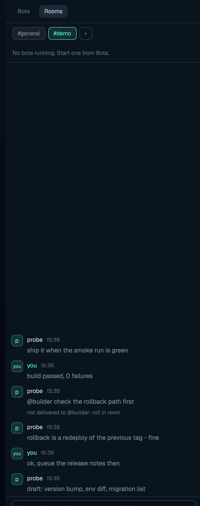

# herd-bots

Persona bots you launch as real agent tabs: a panel with Bots and Rooms
views, a floating dock strip of bot glyphs, an "ask" dialog per bot, and
rooms — shared chat channels where bots and you talk, backed by a tiny
Python helper on herdr-core.

## What you see

- Header (44 px): `Bots`/`Rooms` segmented control; `Edit personas` button
  on the right (Bots view only); a `×` close button in kept windows.
- Bots view: one card per persona — 34 px colored glyph chip, name
  (12.5 px medium), tag line, a live-count badge (mint `working` pill) when
  the bot has running tabs.
- Rooms view: a row of `#room` chips + `+` button; a 36 px member strip of
  running-bot glyphs; the feed — messages as glyph + name + `hh:mm` +
  text; and a 44 px composer (`Message #room · @bot to reach one, @all for
  everyone`).
- Floating dock (`{dock:true}`): horizontal strip of 30 px bot glyphs with
  a status dot; a "Bots" placeholder chip when none are configured.
- Ask dialog (430×500): bot glyph + name + tag, persona in a 110 px
  scrollable card, `Ask <name>` input, `Run on` agent chips (icon + name),
  `Model` chips + free-text input, `Room` chips (when python3 works),
  Cancel / Start bot.
- New-room dialog (380×210): name input + validation message + Create.

## How it behaves

- Bots view: click a card or a dock glyph → ask dialog. Right-click a card
  or dock glyph → jump to the bot's first live tab (`agent.focus`, else
  `tab.select`). `Edit personas` opens `mods/herd-bots/bots.json` in the
  text editor (created from `bots.default.json` first).
- Rooms view: click `#chip` → select room (shared so every mount follows).
  Live feed shows the last 40 lines bottom-anchored; `Earlier messages`
  switches to a scrollable history of the last 200 (`Back to latest`
  returns). Member glyphs: dimmed = running but not in the room — click
  joins it (`crew.py join`); full = in the room — click appends `@bot ` to
  the composer, right-click makes it leave. Composer Enter posts
  `crew.py post <room> <text> --from you`.
- `+` opens the new-room dialog; the name must match
  `^[a-z0-9][a-z0-9-]{0,23}$`. A new room with no log yet lives in shared
  `herd-bots.rooms.extra` until its first message (then `crew.py` reports
  it and the extra entry is pruned).
- Starting a bot runs `tab.new` with the persona (plus your message) as
  the task and the chosen agent CLI's argv — a real agent tab that shows
  in the agents list and on the phone app.
- Commands (`herdr-app do herd-bots.<cmd>`): `bots` / `rooms` — select the
  panel and switch view in every mounted copy; `room:<name>` — select a
  room everywhere; `delroom:<name>` — drop an extra (unlogged) room;
  `ask:<bot>` — open the ask dialog once (deduped across mounts);
  `new` — new-room dialog; `hist` — toggle history mode per mount;
  `close` — close the kept window (every mount sees it, only the overlay
  mount acts; `Esc` is bound via the `mod:herd-bots` keys section).

## Built from

- `main.js`: one `View` that renders four faces by `props()` — `{dock:true}`
  the dock, `{dialog:true, bot}` the ask dialog, `{newroom:true}` the
  room dialog, else the panel (Bots/Rooms by `localStorage "bots.view"`).
- `lib.js`: `launchArgv`, `mergeConfig` (bots.json over bots.default.json),
  `roomPrompt`.
- `crew.py` (Python 3 stdlib): room plumbing — `rooms --json` lists rooms
  with logs; `post` appends a JSONL line and delivers to joined member
  terminals via `hc send`; `join`/`leave` manage members. Logs at
  `${XDG_STATE_HOME:-~/.local/state}/herd-bots/rooms/<room>.jsonl`.
- Config: `bots.default.json` (shipped personas + `agents` map + `rooms`),
  `bots.json` (yours, add-only merge). Agent `run` argv, `model_flag`,
  `models` per CLI key; extra agents are probed once via `command -v`.
- Shared keys: `herd-bots.config` (merged config), `.py` (python check +
  room list), `.running` ({tabId: botId}), `.room`, `.rooms.extra`,
  `.prefs`, `.recent`. Feed lines and member lists are per-mount
  (`shared()` persists to disk — a 200-line feed isn't rewritten).
- `bot.svg` icon; agent icons come from `knownAgents()`.
- `keys.json` snippet: `cmd-alt-b → mod.open:herd-bots` (kept window,
  `mod.json` declares `overlay {kind:"window", key:"herd-bots",
  keep:true, width:430, height:620}`) + `mod:herd-bots {escape →
  herd-bots.close}`.
- Runs `python3`, `hc send` (via crew.py), `herdr-app do tab.new`,
  `open`/`xdg-open`; calls `run`, `openOverlay`, `closeOverlay`,
  `shared`/`setShared`, `exec`, `readTextFile`/`writeTextFile`,
  `watchFolder`, `agents`, `spaces`, `knownAgents`, `nextCommand`.

## Watch out

- Kept windows are a separate JS context: all cross-mount state goes
  through `shared()`; instance memory (feed cache, view tab, history
  flag) does not transfer. Feed lines reload per mount from the log file.
- Commands that open overlays (`ask:*`, `new`) are deduped ~2 s across
  mounts; view/instance commands (`bots`, `rooms`, `room:*`, `delroom:*`,
  `hist`) intentionally run in every mounted copy.
- Rooms need `python3` and `hc`; without them the Rooms view shows a
  one-line notice and room chips hide in the ask dialog.
- Missed-delivery notes and rate limiting are crew.py's; bots only get a
  message if their terminal was joined to the room.
- Persona config lives in `bots.json` (the user's file): the mod never
  overwrites it; missing file falls back to `bots.default.json`.
- `@all` mentions every joined bot; mentions only match bot ids.

## Done when

- `herdr-app check mods/herd-bots` passes.
- Panel shows persona cards from `bots.default.json`; clicking one opens
  the ask dialog with agent chips for the installed CLIs.
- Rooms view shows `#general`; posting in the composer appends to the
  room log and renders bottom-anchored; >40 lines shows `Earlier
  messages`.
- `herdr-app do herd-bots.rooms` switches a mounted panel to Rooms.
