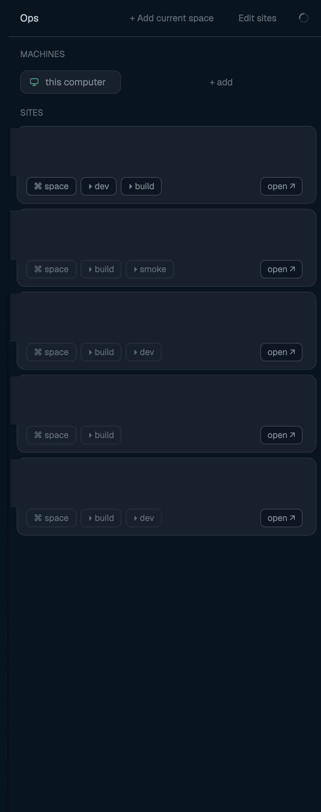

# herd-ops

A launcher for your sites and machines: machine chips on top, one card
per site with a `⌘ space` button, per-site command buttons and an
`open ↗` URL shortcut. No health probes — it opens real spaces and
terminals, so everything lands on the phone app too.

## What you see

- Header (44 px): `Ops`, `+ Add current space`, `Edit sites`, a refresh
  spinner, and a `×` close button in kept windows.
- `MACHINES` strip: one 28 px chip per machine — a monitor/server icon
  colored by layout state (ready = done green, loading = blocked amber,
  unavailable = dim) + name; a `+ add` chip opens `mod.open machine-add`.
- `SITES` list: one card per site — name, optional machine tag, resolved
  folder, tag chips, a right-aligned state hint (`space open` / `no
  folder`), then action chips: `⌘ space`, one `▸ <label>` per configured
  command, `open ↗` when the site has a `url`.
- Footer (26 px): the config path (`mods/herd-ops/sites.json`).
- Empty state: "No sites yet…" + an `Add current space` button.

## How it behaves

- `⌘ space` selects the site's existing space (matched by folder, or by
  name on the same machine) or creates `space.new {name, folder,
  machine?}` — remote sites pass their `machine` through.
- `▸ <cmd>` selects/creates the site space and runs the command as a new
  terminal in the site folder, named `<site>·<label>`.
- `open ↗` runs `open`/`xdg-open` on the site URL.
- `+ Add current space` appends the active space (`name`, `folder`,
  `machine` when remote) to `sites.json` — creating the file from
  `sites.default.json` first — then reloads.
- `Edit sites` creates `sites.json` from the default if missing and opens
  it in the text editor; refresh re-reads it.
- Folder existence is probed per site (`test -d`, remote via `hc exec
  --on <machine>`); a missing folder disables that card's chips and shows
  `no folder`. Sites on other machines keep their paths verbatim; local
  `~`/relative folders resolve against `home()`.
- Config reloads at most once a minute into `shared("herd-ops.config")`
  so every mount renders synchronously.

## Built from

- `main.js`: a single `View` — `machines()` chips, `sites.json` cards.
- `sites.default.json` ships `{"sites": []}`; `sites.json` is the user's
  file, created on first edit. Site shape: `{name, folder, machine?,
  url?, tags?: [...], commands?: [{label, argv:[...]}]}`.
- Shared key `herd-ops.config` = `{sites, folders:{name:bool}, err, at}`.
- `keys.json` snippet: `cmd-alt-o → mod.open:herd-ops` (kept window,
  `mod.json`: `overlay {kind:"window", key:"herd-ops", keep:true,
  width:430, height:560}`) + `mod:herd-ops {escape → herd-ops.close}`.
- Runs `hc exec --on <machine> test -d`, `open`/`xdg-open`; calls `run`
  (`space.new`, `space.select`, `terminal.open`, `mod.open`), `exec`,
  `readTextFile`/`writeTextFile`, `shared`/`setShared`, `spaces`,
  `machines`, `home`, `appHome`, `window`, `props`, `nextCommand` (only
  `close`), `closeOverlay`.
- Icons: shipped `workspace-chrome` server/monitor/spinner SVGs.

## Watch out

- This is a launcher, not monitoring: no uptime checks, no probes beyond
  the one `test -d` per site per minute.
- A kept window is a separate JS context — config arrives via `shared()`,
  so it's fine; but `loading` is per-mount so the refresh icon may spin
  in only one copy.
- `machine` must be a name `hc machine ls` knows; a typo just never
  matches a space and `space.new` fails visibly.
- `sites.json` is the user's file — the mod appends to it but never
  rewrites entries it didn't add; edit it by hand for anything else.
- Command argv runs as a terminal in the site folder, not a shell
  string — quote through the array, not one big string.

## Done when

- `herdr-app check mods/herd-ops` passes.
- Machines strip lists this computer (+ remotes if configured); a site
  card's `⌘ space` opens/selects that space; `▸` commands spawn terminals
  in the right folder; `+ Add current space` writes `sites.json`.
