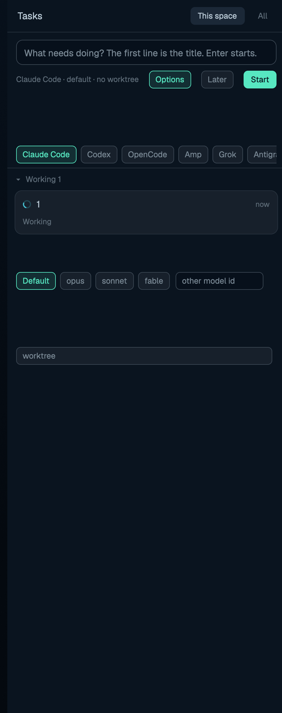

# herd-tasks

A task board that turns "what needs doing" into real agent tabs: write a
brief, pick an agent (and model, and whether to isolate it in a git
worktree), and the task is a named tab whose live status the board reads
back — so everything matches the agents list and the phone app.

## What you see

- Header (44 px): `Tasks`, a red needs-you count badge, a green ready
  count badge, `This space | All` scope toggle, and a `×` close button in
  kept windows.
- Composer block: auto-growing textarea ("What needs doing? The first
  line is the title. Enter starts."), a summary line (`<agent> · <model>
  · worktree from <branch>` / `no worktree`), `Options`, `Later` and a
  solid `Start` button.
- Options row (toggleable): installed-agent chips, model chips
  (`Default` + configured + a free-text "other model id" input), and a
  `worktree` toggle.
- Board: collapsible sections — Needs you, Ready, Working, Queued,
  To do, Done — with `▾/▸` fold arrows and counts. Each task card: title,
  age (`now/5m/3h/2d`), a dim status line (waiting detail, stats, agent),
  brief, `branch from base`, worktree path, leftover note, and action
  chips (Start / Start now / Open / Review / Open review / Accept /
  Mark done / Ask agent to rebase / Discard / Reopen / Remove).
- Footer (26 px): `Track current tab` — adopt the focused tab as a task.
- Confirm dialog (`{confirm:true, task, action}`): "Discard …?" card with
  the consequence text and Cancel/Discard buttons.

## How it behaves

- Enter (or `Start`) creates the task and launches it; `Later` queues it.
  Sections regroup live every 5 s from each task's real state: an agent
  blocked shows under **Needs you** (red), finished/unlooked under
  **Ready** (green, with a `Ready · tab closed` variant), running under
  **Working**, queued tasks under **Queued** (auto-started up to
  `max_running`), unstarted under **To do**, accepted under **Done**
  (folded by default).
- `This space` shows only tasks bound to the active space; `All` shows
  every space's. Scope, options-open, and per-space agent/model/worktree
  picks persist in `localStorage`.
- `worktree` on (default when the space is a repo): the task gets a new
  branch + worktree at `~/.herdr/worktrees/<repo>/<branch>`; `Accept`
  merges the branch back and removes the worktree, `Discard` asks to
  delete branch + worktree + tab. Off: the agent works in the repo
  directly; accept = `Mark done`.
- `Review` opens a review tab (fresh agent asked to review the diff);
  `Ask agent to rebase` sends a rebase instruction to a conflicted task's
  terminal via `hc send`; `Reopen` resurrects a task whose tab closed.
- Agent CLIs are probed per `tasks.json` `agents` map (`command -v` —
  uninstalled ones are hidden); `agentCfg` supplies `model_flag`/`models`.
- Commands (`herdr-app do herd-tasks.<cmd>`): `new` — focus the panel's
  composer in every mount; `<action>:<taskId>` — the card actions
  (`start`, `open`, `review`, `accept`, `discard`, `rebase`, `reopen`,
  `remove`) run once across mounts (deduped ~2 s); `close` — close the
  kept window (broadcast, only the overlay mount acts; `Esc` bound via
  `mod:herd-tasks`).

## Built from

- `main.js`: the board `View` plus a `props {confirm}` discard dialog.
- `lib.js`: `slugify`, `branchName`, `sectionOf` (task+tab → section),
  `nextToStart`, `launchArgv`, `taskPrompt`, `reviewPrompt`,
  `mergeTasksConfig`, `failureMessage`.
- `git.js`: worktree helpers (repo probe, branch/worktree create, merge,
  remove) — run via `exec("git"/"sh")` on the task's machine.
- State: tasks live in `shared("herd-tasks.tasks")` keyed by id — tab,
  space, repo/branch/path, agent/model, state, timestamps; config in
  `shared("herd-tasks.cfg")` from `tasks.json` (or `tasks.default.json`,
  which ships `max_running: 4`, `worktree: true`, agent argv map).
- Tasks are launched through `herdr-app do tab.new --name <title> --task
  <prompt> --argv <agent argv>` so the phone app sees them; remote tasks
  pass the machine through `hc`.
- `keys.json` snippet: `cmd-alt-t → mod.open:herd-tasks` (kept window,
  `mod.json` declares `overlay {kind:"window", key:"herd-tasks",
  keep:true, width:440, height:640}`) + `mod:herd-tasks {escape →
  herd-tasks.close}`.
- herdr calls: `spaces`, `agents`, `panes`, `focused`, `run`,
  `openOverlay`/`closeOverlay`, `exec`, `knownAgents`,
  `readTextFile`/`writeTextFile`, `appHome`, `nextCommand`, `props`.

## Watch out

- Section assignment is derived (`sectionOf`): a task is "Needs you" only
  while its tab's agent is blocked — kill the tab and it falls to Ready/
  Reopen territory; never store the section on the task.
- `tab.new` is spawned through the `herdr-app` CLI (not `run`) so a task
  can target another machine's space and still come back with an id —
  the CLI must be on PATH.
- Merge/discard run `git` on the task's machine via `exec(..., {on})`;
  remote machines need git + the worktree base layout.
- Kept window = separate JS context: task state is in `shared()`, but
  per-mount composer/scope/expanded stay local — expected.
- `max_running` caps auto-starts; `Track current tab` only makes a
  non-worktree tracked entry — it cannot adopt the tab's diff.
- The discard dialog deletes a branch + worktree for real — hence the
  explicit confirm face.

## Done when

- `herdr-app check mods/herd-tasks` passes.
- Composer → Start spawns a named agent tab; the card moves To do →
  Working → Ready/Needs you as the agent's status changes; counts in the
  header track.
- In a git space with `worktree` on, the card shows `branch from base`
  and a `~/.herdr/worktrees/...` path; Accept merges and removes it.
