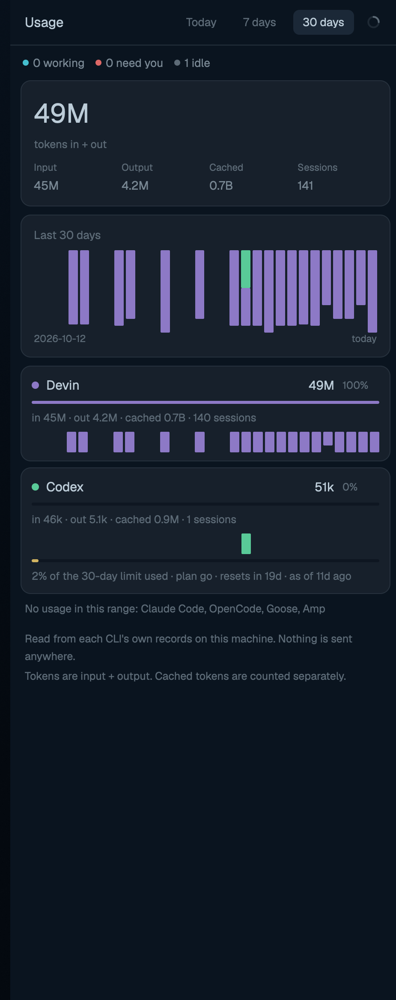

# herd-usage

Agent-CLI token usage for this machine, read from each CLI's own local
records: a Today/7 days/30 days panel with a totals card, a 30-day stacked
bar chart, per-agent cards with share bars, plan-limit meters and
per-model breakdowns. Nothing is sent anywhere — it's local files only.

## What you see

- Header (44 px): `Usage`, range chips `Today` `7 days` `30 days`, a
  spinner/refresh button, and a `×` close button in kept windows.
- A live line: `N working · N need you · N idle` from the current agents.
- Totals card: big number (`4.9M`), "tokens in + out", and Input/Output/
  Cached/Sessions stat chips, plus cost and credits lines when a CLI
  records them.
- `Last 30 days` card: a stacked bar per day (one color per agent),
  range-dimmed outside the selected window, axis labels first-of-range
  and today.
- One card per agent: color dot + name, total + share %, a 3 px share
  bar, `in/out/cached/sessions` line, a 20-bar mini series for the
  selected range, an optional plan-limit meter (`used % of the window
  limit · plan · resets in · as of`), agent notes, read errors, and —
  expanded — up to 8 per-model rows with 2 px bars.
- Footer: which CLIs have no records in range, and the privacy note.

## How it behaves

- Range chips switch `usage.range` (`today`/`d7`/`d30`, persisted in
  `localStorage`); every number, bar highlight and agent card re-derives
  from the shared document — no refetch.
- The refresh button and `herdr-app do herd-usage.refresh` set a shared
  `herd-usage.refresh` timestamp (throttled to one write / 3 s); the
  loader — `abyss-status` in the abyss layout, or the mount itself when
  no loader runs — collects in response. `herd-usage.range:<id>` sets the
  range per mount; `herd-usage.close` closes the kept window (broadcast
  to every mount, only the overlay mount acts; `Esc` bound via
  `mod:herd-usage`).
- Each mount polls `want()` every 60 s: it asks for a collection when the
  doc is missing or older than 5 min.
- Click an agent card to expand its per-model breakdown; click again to
  collapse.
- Agents needing attention count in the live line comes from `agents()`
  — it changes without touching the usage data.

## Built from

- `main.js`: the panel/window `View`. Renders **only** from shared state
  so every mount — panel, kept window (a separate JS context) — draws the
  same document.
- `usage.py` (Python 3.8+, stdlib only): the frozen collector. Reads
  `~/.claude`, `~/.codex`, `~/.local/share/{opencode,devin,goose,amp}`
  records (jsonl/zst/sqlite/json) and prints one JSON doc
  (`usage.py --days 30`). No network.
- `lib.js`: `fmt`/`fmtShort` number formatting, `tokens`, `cached`,
  `windowLabel`, `resetsIn`, `ago`, `colorOf` (per-agent palette).
- Shared keys: `herd-usage.doc` (the whole document — single render
  source), `herd-usage.meta` (`{at, since?, loading, error}` → spinner
  and error line), `herd-usage.refresh` (last-ask ms), and
  `herd-usage.summary` (`{at, today, d7}` → the status-bar chip).
- Loader contract: a spawn-capable always-mounted view (abyss's
  `abyss-status`) runs the collector when the doc is missing/stale or
  `refresh > meta.at`, writing doc+meta+summary; it checks the script
  exists first, reports "not installed" once, backs off 60 s on failure.
  A mount with no loader after a grace period collects itself, so the
  mod also works standalone.
- `chart.svg` (status-bar icon); `keys.json` snippet `cmd-alt-u →
  mod.open:herd-usage` (kept window, `mod.json`: `overlay {kind:"window",
  key:"herd-usage", keep:true, width:470, height:680}`) + `mod:herd-usage
  {escape → herd-usage.close}`.
- herdr calls: `agents`, `shared`/`setShared`, `exec`, `appHome`,
  `nextCommand`, `closeOverlay`, `props`, `theme`, `localStorage`,
  `cx.timer.every`, `cx.spawn`.

## Watch out

- Kept windows are a separate JS context — module statics do not
  transfer. This is why the document lives in `shared()` and the loader
  in a stable mount: a mount must never assume its own fetch ran.
- `shared()` persists to disk: the doc is ~one screen of JSON per mount;
  don't write it more often than the loader's 5-min cadence, and never
  put feed-like large arrays in there.
- Token fields are per-CLI semantics (see usage.py docstring): `cost` is
  USD only where recorded, `credits` are the CLI's own and never mixed
  into cost.
- Days are local calendar days; a fresh install can legitimately render
  "No agent CLI records found".
- Without python3 the loader marks meta.error once and the view shows
  the error line, not a spinner loop.
- `usage.py` is a frozen contract — its JSON shape is what lib.js and
  the summary key assume; change them together.

## Done when

- `herdr-app check mods/herd-usage` passes.
- With the abyss layout, the status bar shows `<n>M today` and the panel
  renders the totals card + chart + agent cards from `herd-usage.doc`.
- `mod.open:herd-usage` opens a kept window that renders the same filled
  view (not a permanent spinner).
- The refresh button bumps `herd-usage.meta.at`; the range chips change
  which bars are lit.
